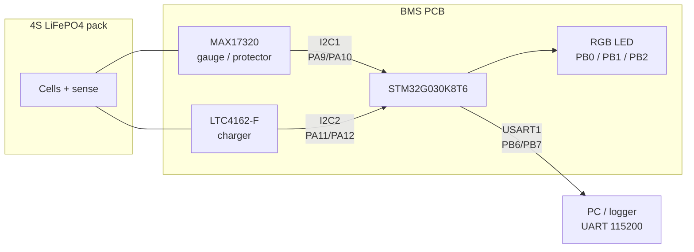
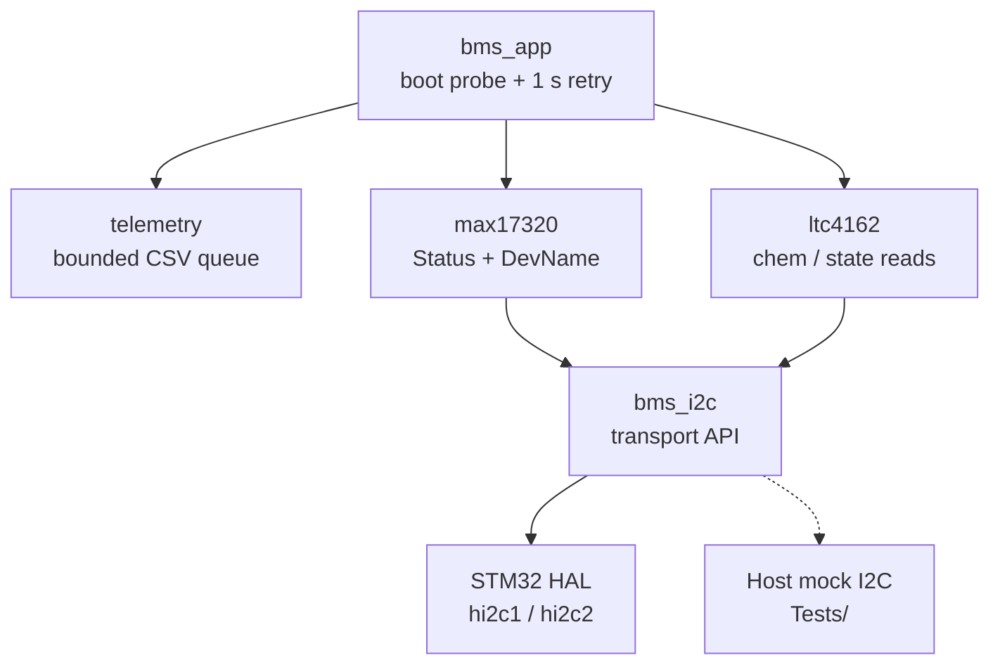

# Bionix BMS Firmware

Firmware for the STM32G030-based battery management board: **monitor first, control later**.

The MCU talks to a **MAX17320** fuel gauge/protector and an **LTC4162-F** charger over **separate I2C buses**, then reports status over UART. Full requirements live in [`BMS_FIRMWARE_SPEC.md`](BMS_FIRMWARE_SPEC.md); agent rules are in [`AGENTS.md`](AGENTS.md).

> **Hardware reality check**  
> The assembled PCB has **not** been powered, programmed, or validated.  
> A clean compile and passing mock tests do **not** mean the board is electrically safe.

---

## What’s working now (Milestone 1)

| Area | Status |
| --- | --- |
| Device presence / identity reads | Done (read-only) |
| Mockable I2C layer + host unit tests | Done |
| Bounded UART CSV logs (`BOOT`, `EVENT`) | Done |
| Config / NVM write APIs | Stubs only — always return `WRITE_DISABLED` |
| Live charging, balancing, thresholds, SOC calibration | **Not started** |

---

## System overview



Both ICs sit on **their own bus** — not a shared I2C line.

### Software layout



Application code lives under `BMS/`. CubeMX-generated `Core/` and `Drivers/` are left intact; edits to generated files stay inside `USER CODE` regions only.

---

## Pin map (verified against `.ioc`)

```text
                    STM32G030K8T6
                 ┌──────────────────┐
         Alert ──┤ PA1              │
     SMB Alert ──┤ PA3              │
     BMS Alert ──┤ PC6              │
                 │                  │
   MAX17320 SCL ─┤ PA9   I2C1       │
   MAX17320 SDA ─┤ PA10             │
                 │                  │
   LTC4162 SCL ──┤ PA11  I2C2       │
   LTC4162 SDA ──┤ PA12             │
                 │                  │
      UART TX ───┤ PB6   USART1     ├──► debug serial 115200 8N1
      UART RX ───┤ PB7              │
                 │                  │
      LED Red ───┤ PB0              │
    LED Green ───┤ PB1              │
     LED Blue ───┤ PB2              │
                 │                  │
         SWDIO ──┤ PA13             ├──► ST-LINK
         SWCLK ──┤ PA14             │
                 └──────────────────┘

  Clock: HSI 16 MHz
  SPI1 (PA4–PA7): optional header only — unused by BMS firmware
```

| Signal | Pins | Notes |
| --- | --- | --- |
| I2C1 → MAX17320 | PA9 SCL, PA10 SDA | Matches schematic |
| I2C2 → LTC4162 | PA11 SCL, PA12 SDA | CubeMX may label these `PA11 [PA9]` / `PA12 [PA10]` |
| Debug UART | PB6 TX, PB7 RX | 115200 8N1 |
| RGB LED | PB0 / PB1 / PB2 | Active polarity **unverified** on board |
| Alerts | PA1, PA3, PC6 | Rising edge, no pull; EXTI IRQ **not enabled** yet |
| Programming | PA13 / PA14 | SWD — keep available |

---

## Open assumptions (do not “fix” quietly)

1. **MAX17320 I2C address** — Spec table said 7-bit `0x6C` → HAL `0xD8`. Datasheet lists write-form `6Ch` / `16h`. Firmware uses HAL **`0x6C`** (main) and **`0x16`** (NV). Confirm with an I2C scan on first bring-up.
2. **I2C timing mismatch** — `.ioc` has `0x00503D58`; generated `i2c.c` uses `0x00100D14`. Left as generated; re-sync in CubeMX if needed.
3. **Alert polarity / LED polarity** — not measured on the real board yet.
4. **MAX17320 factory config** — **not** validated for this 4S LiFePO4 pack. The Bioenno pack may also have its own PCM/BMS; cell-tap access needs a separate check.
5. **Sense resistors** — schematic values coded for later use: R_CS **2 mΩ**, R_SNSB **4 mΩ**, R_SNSIN **8 mΩ** (unused in Milestone 1 math).
6. **LTC4162 chemistry** — probe expects `chem == 4` (FAD). Without charger input power, `cell_count` may read `0`; that alone is not treated as a hard fail.

---

## Build & test

### Host mock tests

Needs MSYS2 `gcc` and the CMake that ships with STM32CubeIDE (paths below match this machine).

```powershell
$cmake = "C:\ST\STM32CubeIDE_2.2.0\STM32CubeIDE\plugins\com.st.stm32cube.ide.mcu.externaltools.cmake.win32_1.1.200.202605190741\tools\bin\cmake.exe"
$env:PATH = "C:\msys64\ucrt64\bin;C:\msys64\usr\bin;$env:PATH"

cd c:\Users\Brayd\Bionx\STM_Configs\Tests
& $cmake -S . -B build -G "Unix Makefiles" -DCMAKE_C_COMPILER=gcc
& $cmake --build build

$ctest = "C:\ST\STM32CubeIDE_2.2.0\STM32CubeIDE\plugins\com.st.stm32cube.ide.mcu.externaltools.cmake.win32_1.1.200.202605190741\tools\bin\ctest.exe"
& $ctest --test-dir build --output-on-failure
# or: .\build\test_milestone1.exe
```

### STM32 target (CubeIDE)

1. Open this folder as the STM32CubeIDE project.
2. `BMS/` is already a source folder; `BMS/Inc` is on the include path (Debug + Release).
3. **Project → Build Project** (Debug).

Last checked headless Debug build: **0 errors, 0 warnings** → `STM_Configs.elf`.

---

## UART log format (Milestone 1)

Examples:

```text
BOOT,0.1.0,M1_readonly_monitor
EVENT,BOOT_PROBE,MAX17320 ok DevName=0x420A Status=0x0002
EVENT,I2C_FAIL,I2C1,0x6C,reg=0x21,status=NACK
EVENT,STATE,FAULT_SW_DIAG
```

Logs go through a **bounded queue**. If I2C fails in a storm, extra records are **dropped** (and counted) so monitoring does not stall.

---

## Safety rules (always)

- `WriteConfig` APIs return `BMS_ERR_WRITE_DISABLED` and **never** touch the bus.
- Software `FAULT` is a **diagnostic state only** — it does not cut charge/discharge paths.
- Threshold helpers return `BMS_ERR_NOT_CONFIGURED` until limits are explicitly approved.
- Do **not** power, flash, or run the real PCB until a separate hardware review says so.
